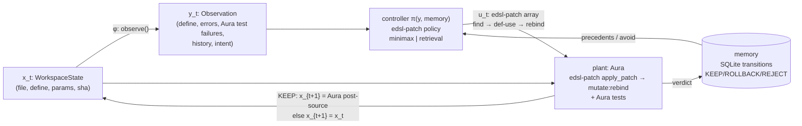
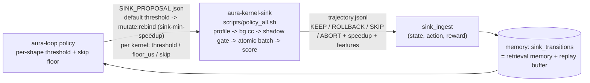

# aura-loop

[](LICENSE)

把 Aura 代码库当成一个**状态空间**做闭环控制：观测当前代码 → 控制器（来自 [edsl-patch](https://github.com/cybrid-systems/edsl-patch)）给出一条 EDSL patch → 真实 Aura 执行 `mutate:rebind` 并门禁 → 结果写回记忆库 → 下一步观测新状态。

*Closed-loop control over an Aura workspace: observe the code, let an edsl-patch controller emit one EDSL patch, have a real Aura binary apply and gate it (`mutate:rebind` + type checker + tests), write the outcome back to memory, and observe the successor state.*

## 闭环 / The loop



One step (`aura_loop/loop.py::step`):

1. **State x** — `WorkspaceState`: file text, target define (canonical `(define (f args) body)`), params, sha256 prefix.
2. **Observation y = φ(x)** — `observe()`: define source, toy static errors (fake plant only), **failing tests run on Aura** (real plant `probe`), per-symbol KEEP/ROLLBACK/REJECT counts, and an intent sentence derived only from those errors.
3. **Control u = π(y, memory)** — `EdslPatchController`: builds an edsl-patch sample input (`source`, `intent`, `observe{hot,frozen,errors,precedents,avoid}`) and returns an edsl-patch **patch array** validated by edsl-patch's own `validate_patch`.
4. **Plant** — `SoftPlant`: boundary admission (one define, same name/signature, legal patch) → **REJECT**; edsl-patch `apply_patch` drives Aura (`query :find/:def-use`, `ast:snapshot`, `mutate:rebind`, `eval-current`) — Aura's type checker / MutationBoundary refusal → **ROLLBACK**; Aura tests on the post-mutation source fail → **ROLLBACK**; otherwise **KEEP** and x' is Aura's own `current-source`.
5. **Writeback** — every non-identity step is a row in memory; a REJECT/ROLLBACK body is never proposed again for that symbol, so failures change the next decision. Step t+1 observes x'.

## 哪些来自 edsl-patch / What comes from where

| | edsl-patch (`third_party/edsl-patch`, submodule @ `4f2b3c0`) | aura-loop |
|---|---|---|
| control signal format | patch schema (`schema/patch.md`), `validate_patch`, hot/frozen rules | — |
| LLM policy | SFT prompt `export_sft.to_sft` (`SYSTEM_CONTRACT`), `pipeline.baseline._ask` / `_parse`, MiniMax config `pipeline.intent.load_minimax` | one repair turn with the validator error; memory precedents/avoid in `observe`; fallback to retrieval (labelled) |
| retrieval policy | `parse_aura.patch_for` (precedent body → patch) | SQLite memory, similarity, skip-failed |
| apply on Aura | `apply.apply_patch` / `apply_succeeded` (driver → `mutate:rebind`) | boundary admission, post-source → x', Aura test gate, verdict |
| state / observation / loop / memory | — | everything else |

edsl-patch is imported, not copied (`aura_loop/edsl_bridge.py`; search order `$EDSL_PATCH_DIR`, `third_party/edsl-patch`, `../edsl-patch`).

Controller policies (`--policy`): `minimax` (needs `~/.config/aura-build/minimax.env`), `retrieval` (offline, used by tests), `auto` (minimax if configured, else retrieval). The control's `source` field says which one actually produced u (`edsl-patch:minimax:<model>`, `…:repaired1`, `edsl-patch:minimax-fallback-retrieval:memory:<id>`, `edsl-patch:retrieval:memory:<id>`).

## 运行 / Run

```bash
git clone --recursive https://github.com/cybrid-systems/aura-loop && cd aura-loop
# (existing clone: git submodule update --init)

# real plant (default): any Aura build with mutate:rebind
export AURA_BIN=/path/to/aura/build/aura AURA_LIB=/path/to/aura/lib
python3 -m aura_loop --e2e -v                 # JSON transitions on stdout, trace on stderr
python3 -m aura_loop --e2e --policy retrieval # no network

# no Aura binary: must opt in explicitly
python3 -m aura_loop --e2e --plant fake --policy retrieval

python3 -m unittest discover -s tests -v      # real-Aura tests run only when AURA_BIN is set
```

`--e2e` prints `{plant, plant_info, controller, transitions:[{state_before, observation, control, verdict, reason, memory_id, state_after}], final_state, converged}`. Real-Aura runs: [`docs/e2e-sample.json`](docs/e2e-sample.json) (retrieval policy: REJECT → KEEP → NOOP) and [`docs/e2e-minimax-sample.json`](docs/e2e-minimax-sample.json) (MiniMax policy after one repair turn: KEEP → NOOP).

Aura host: edsl-patch's collection pipeline pins Aura `3b21350` (`pins/aura-host.json`) for data; the loop itself only needs `mutate:rebind`, `query`, `ast:snapshot`, `current-source` and `json-encode`. `plant_info` records the binary sha256 and source HEAD of whatever `AURA_BIN` was used.

Trace on `fixtures/tiny.scm` (`clamp` with `(min x)`; `fixtures/tiny.tests.scm` fails `clamp-high` on Aura):
step 1 the controller replays the most similar precedent, which changes the signature → **REJECT** (written back);
step 2 it proposes `(max lo (min x hi))` → Aura `mutate:rebind` #t, tests pass on Aura → **KEEP**, x advances to Aura's post-source;
step 3 observation healthy → **NOOP**.

Legacy demo (retrieval controller + FakePlant): `python3 -m aura_loop --demo`.

## aura-kernel-sink 闭环 / Sink-policy loop

第二个状态空间是 [aura-kernel-sink](https://github.com/cybrid-systems/aura-kernel-sink)：把 Aura workspace 里的热点 f64vector 循环下沉成 C kernel。aura-loop 不碰代码本身，只学一件事：哪种形状的 kernel 值得下沉，阈值该设多高。

*Second state space: [aura-kernel-sink](https://github.com/cybrid-systems/aura-kernel-sink), which sinks hot f64vector loops of an Aura workspace into C kernels. aura-loop does not touch the code here; it learns which kernel shapes are worth sinking and how high the speedup threshold should be.*



- **Ingest (`aura_loop/sink_ingest.py`)**：每行轨迹变成 `sink_transitions` 里的一行，和原来的 `transitions` 在同一个 SQLite 里。
  - state：kernel 形状（arity、向量参数个数、向量长度、op 构成，取自行里的 `features`）加实测 Soft 成本。
  - action：sink 还是 skip，以及当时生效的阈值和 Soft 下限。
  - reward：KEEP 为 `log(speedup)`，ROLLBACK 为 −1，ABORT 为 −2，SKIP 为 0（compile 阶段的 SKIP 为 −0.1）。
  - shape bucket 由向量个数、数学 op、长度档（log4）组成。重复 ingest 同一文件不会多出行。
  - 只 ingest：`python3 -m aura_loop --sink-ingest build/trajectory.jsonl --db mem.db`。
- **Policy (`aura_loop/sink_policy.py`)**：
  - `knn`：先看同 bucket 的先例，没有就找特征向量最近的 bucket。
    - 有实测加速比时，阈值取 0.7 × 该形状最差的实测值。这样健康的 kernel 都能留下，掉到远低于该形状正常水平的 kernel 仍会被 ROLLBACK（有测试覆盖）。
    - 若该形状最好的实测值都低于 1.5×，就学一个保本下限 `1.5 × soft_us / speedup`，让 kernel-sink 在 profile 阶段直接 SKIP。
    - vkgen 编不了的 kernel 直接 skip。
  - `bandit`：在每个 bucket 上对 (action, 阈值, 下限) 网格做 ε-greedy。
  - RL hook：`SinkPolicy.replay(mem)` 给出 (state, action, reward, next_state) 元组，供后续学习器训练，目前没有任何东西用它训练。
- **Loop (`aura_loop/sink_loop.py`, `python3 -m aura_loop --sink`)**：
  - 每轮写一个 proposal，调 kernel-sink 的 `scripts/policy_all.sh`（真 Aura、真 cc、每个 kernel 一个进程），ingest 新轨迹，再出下一轮 proposal。
  - 固定阈值臂和学习臂各用独立的 memory，跑同样的轮数，比较每轮的 KEEP/ROLLBACK、保留下来的加速比和 reward。

```bash
export AURA_BIN=/path/to/aura/build-rel/aura
python3 -m aura_loop --sink --sink-repo ../aura-kernel-sink --rounds 4 --baseline-threshold 10 --learner knn -v \
    --sink-workdir docs/sink/run-knn --out docs/sink/report-knn.json
python3 scripts/sink_table.py docs/sink/report-knn.json
```

### 结果 / Results

环境：Aura `542fb9254`，aura-kernel-sink `172527b`（见 `pins/aura.json`）。9 个 kernel：6 个 5000 元素的向量循环；`vsum-short`、`vdot-short` 是 128 元素版本，FFI 开销占主导，下沉后反而只有 Soft 的 0.25–0.4 倍速度；`vbad-mix` vkgen 编不了。固定阈值臂固定为 10，学习臂第 1 轮从同样的先验 10 起步。

*Aura `542fb9254`, aura-kernel-sink `172527b` (`pins/aura.json`). Nine kernels: six 5000-element vector loops; `vsum-short` and `vdot-short` are 128-element copies where FFI overhead dominates, so sinking them gives only 0.25–0.4× of Soft's speed; `vbad-mix` cannot be compiled by vkgen. The fixed arm uses threshold 10; the learning arm starts round 1 from the same prior of 10.*

| arm | round | KEEP | ROLLBACK | SKIP | kept speedup sum | reward |
|---|---|---|---|---|---|---|
| fixed 10 | 1 | 2 | 6 | 1 | 25.75 | −1.01 |
| fixed 10 | 2 | 2 | 6 | 1 | 22.2 | −1.29 |
| fixed 10 | 3 | 2 | 6 | 1 | 22.8 | −1.24 |
| fixed 10 | 4 | 2 | 6 | 1 | 25.05 | −1.06 |
| knn | 1 | 3 | 5 | 1 | 32.43 | 2.04 |
| knn | 2 | 6 | **0** | 3 | 62.85 | 13.85 |
| knn | 3 | 6 | **0** | 3 | 58.3 | 13.36 |
| knn | 4 | 6 | **0** | 3 | 57.5 | 13.40 |

第 2–4 轮：固定阈值 KEEP 6 / ROLLBACK 18，保留下来的加速比之和 70.05；knn 为 KEEP 18 / ROLLBACK 0，加速比之和 178.65。knn 第 2 轮的 proposal：
- 长向量 kernel 各自拿到形状阈值 4.5–8.1。
- `vsum-short`、`vdot-short` 学到保本下限 788 / 643 µs，在 profile 阶段 SKIP，不再编译、不再回滚。
- `vbad-mix` 直接 skip。

bandit（`docs/sink/report-bandit.json`）收敛得慢：第 2–4 轮 KEEP 11 / ROLLBACK 9，第 4 轮达到 KEEP 6 / ROLLBACK 1。它要靠探索去试阈值网格。

固定阈值的问题不在于 10 太高或太低，而在于一个阈值套不住所有形状。

*Rounds 2–4: fixed is KEEP 6 / ROLLBACK 18 with a kept speedup sum of 70.05; knn is KEEP 18 / ROLLBACK 0 with 178.65. knn's round-2 proposal:*
- *each long-vector kernel gets its own shape threshold, 4.5–8.1;*
- *`vsum-short` and `vdot-short` get break-even floors of 788 / 643 µs and are SKIPped at the profile stage, with no more compiles or rollbacks;*
- *`vbad-mix` is skipped outright.*

*The bandit converges more slowly (rounds 2–4: KEEP 11 / ROLLBACK 9; round 4 reaches KEEP 6 / ROLLBACK 1) because it has to explore the threshold grid.*

*The problem with a fixed threshold is not that 10 is too high or too low; it is that no single threshold fits every shape.*

Per-round proposals, trajectories and logs: `docs/sink/run-knn/`, `docs/sink/run-bandit/`.

## Layout

```
aura_loop/state.py           WorkspaceState (x)
aura_loop/observe.py         φ: x -> Observation (y), plant probe
aura_loop/edsl_bridge.py     locate/import edsl-patch
aura_loop/edsl_controller.py EdslPatchController (u): minimax | retrieval policy, edsl-patch patch arrays
aura_loop/controller.py      Control, RetrievalController (legacy)
aura_loop/plant.py           SoftPlant (real Aura via edsl-patch apply + Aura tests), FakePlant
aura_loop/loop.py            step / run, JSON transitions
aura_loop/memory.py          SQLite authority table, retrieve, writeback
aura_loop/sexpr.py           reader, define <-> lambda, toy arity checker
aura_loop/sink_ingest.py     aura-kernel-sink trajectory.jsonl -> sink_transitions (state, action, reward)
aura_loop/sink_policy.py     per-shape threshold / skip floor: knn | bandit, replay() RL hook
aura_loop/sink_loop.py       proposal -> scripts/policy_all.sh -> ingest; fixed vs learned comparison
scripts/sink_table.py        markdown table of a --sink report
pins/aura.json               Aura + aura-kernel-sink commits the sink results were produced with
fixtures/tiny.scm(.tests.scm) clamp fixture + Aura tests
third_party/edsl-patch       submodule
```

## Limits / next

- Sink loop: 9 fixture kernels; the threshold rule is a heuristic over retrieved precedents (RL learner not yet plugged into `replay()`); timings are ms-timer, best of 3, on a shared box.
- One define per state; fixture-scale only. Next: real repos (aura-pad / aura-redis units from edsl-patch's pipeline) as the state space.
- MiniMax zero-shot often emits an illegal patch (edsl-patch batch1 baseline: 1/12); the loop repairs once, then falls back to memory and says so.
- Memory similarity is token overlap; the `embedding` column is reserved for vector recall.
- Aura type-check gaps (cybrid-systems/aura#4397, #4398) can make the plant ROLLBACK valid code.

## License

Apache License 2.0 — see [LICENSE](LICENSE) and [NOTICE](NOTICE). Copyright 2026 Cybrid Systems.
