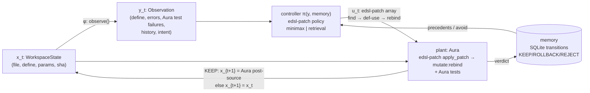

# aura-loop

[](LICENSE)

把 Aura 代码库当成一个**状态空间**做闭环控制：观测当前代码 → 控制器（来自 [edsl-patch](https://github.com/cybrid-systems/edsl-patch)）给出一条 EDSL patch → 真实 Aura 执行 `mutate:rebind` 并门禁 → 结果写回记忆库 → 下一步观测新状态。

*Closed-loop control over an Aura workspace: observe the code, let an edsl-patch controller emit one EDSL patch, have a real Aura binary apply and gate it (`mutate:rebind` + type checker + tests), write the outcome back to memory, and observe the successor state.*

## 闭环 / The loop



One step (`aura_loop/loop.py::step`):

1. **State x** — `WorkspaceState`: file text, target define (canonical `(define (f args) body)`), params, sha256 prefix.
2. **Observation y = φ(x)** — `observe()`: define source, toy static errors (fake plant only), **failing tests run on Aura** (real plant `probe`), per-symbol KEEP/ROLLBACK/REJECT counts, and an intent sentence derived only from those errors.
3. **Control u = π(y, memory)** — `EdslPatchController`: builds an edsl-patch sample input (`source`, `intent`, `observe{hot,frozen,errors,precedents,avoid}`) and returns an edsl-patch **patch array** validated by edsl-patch's own `validate_patch`.
4. **Plant** — `SoftPlant`: boundary admission (one define, same name/signature, legal patch) → **REJECT**; edsl-patch `apply_patch` drives Aura (`query :find/:def-use`, `ast:snapshot`, `mutate:rebind`, `eval-current`) — Aura's type checker / MutationBoundary refusal → **ROLLBACK**; Aura tests on the post-mutation source fail → **ROLLBACK**; otherwise **KEEP** and x' is Aura's own `current-source`.
5. **Writeback** — every non-identity step is a row in memory; a REJECT/ROLLBACK body is never proposed again for that symbol, so failures change the next decision. Step t+1 observes x'.

## 哪些来自 edsl-patch / What comes from where

| | edsl-patch (`third_party/edsl-patch`, submodule @ `4f2b3c0`) | aura-loop |
|---|---|---|
| control signal format | patch schema (`schema/patch.md`), `validate_patch`, hot/frozen rules | — |
| LLM policy | SFT prompt `export_sft.to_sft` (`SYSTEM_CONTRACT`), `pipeline.baseline._ask` / `_parse`, MiniMax config `pipeline.intent.load_minimax` | one repair turn with the validator error; memory precedents/avoid in `observe`; fallback to retrieval (labelled) |
| retrieval policy | `parse_aura.patch_for` (precedent body → patch) | SQLite memory, similarity, skip-failed |
| apply on Aura | `apply.apply_patch` / `apply_succeeded` (driver → `mutate:rebind`) | boundary admission, post-source → x', Aura test gate, verdict |
| state / observation / loop / memory | — | everything else |

edsl-patch is imported, not copied (`aura_loop/edsl_bridge.py`; search order `$EDSL_PATCH_DIR`, `third_party/edsl-patch`, `../edsl-patch`).

Controller policies (`--policy`): `minimax` (needs `~/.config/aura-build/minimax.env`), `retrieval` (offline, used by tests), `auto` (minimax if configured, else retrieval). The control's `source` field says which one actually produced u (`edsl-patch:minimax:<model>`, `…:repaired1`, `edsl-patch:minimax-fallback-retrieval:memory:<id>`, `edsl-patch:retrieval:memory:<id>`).

## 运行 / Run

```bash
git clone --recursive https://github.com/cybrid-systems/aura-loop && cd aura-loop
# (existing clone: git submodule update --init)

# real plant (default): any Aura build with mutate:rebind
export AURA_BIN=/path/to/aura/build/aura AURA_LIB=/path/to/aura/lib
python3 -m aura_loop --e2e -v                 # JSON transitions on stdout, trace on stderr
python3 -m aura_loop --e2e --policy retrieval # no network

# no Aura binary: must opt in explicitly
python3 -m aura_loop --e2e --plant fake --policy retrieval

python3 -m unittest discover -s tests -v      # real-Aura tests run only when AURA_BIN is set
```

`--e2e` prints `{plant, plant_info, controller, transitions:[{state_before, observation, control, verdict, reason, memory_id, state_after}], final_state, converged}`. Real-Aura runs: [`docs/e2e-sample.json`](docs/e2e-sample.json) (retrieval policy: REJECT → KEEP → NOOP) and [`docs/e2e-minimax-sample.json`](docs/e2e-minimax-sample.json) (MiniMax policy after one repair turn: KEEP → NOOP).

Aura host: edsl-patch's collection pipeline pins Aura `3b21350` (`pins/aura-host.json`) for data; the loop itself only needs `mutate:rebind`, `query`, `ast:snapshot`, `current-source` and `json-encode`. `plant_info` records the binary sha256 and source HEAD of whatever `AURA_BIN` was used.

Trace on `fixtures/tiny.scm` (`clamp` with `(min x)`; `fixtures/tiny.tests.scm` fails `clamp-high` on Aura):
step 1 the controller replays the most similar precedent, which changes the signature → **REJECT** (written back);
step 2 it proposes `(max lo (min x hi))` → Aura `mutate:rebind` #t, tests pass on Aura → **KEEP**, x advances to Aura's post-source;
step 3 observation healthy → **NOOP**.

Legacy demo (retrieval controller + FakePlant): `python3 -m aura_loop --demo`.

## Layout

```
aura_loop/state.py           WorkspaceState (x)
aura_loop/observe.py         φ: x -> Observation (y), plant probe
aura_loop/edsl_bridge.py     locate/import edsl-patch
aura_loop/edsl_controller.py EdslPatchController (u): minimax | retrieval policy, edsl-patch patch arrays
aura_loop/controller.py      Control, RetrievalController (legacy)
aura_loop/plant.py           SoftPlant (real Aura via edsl-patch apply + Aura tests), FakePlant
aura_loop/loop.py            step / run, JSON transitions
aura_loop/memory.py          SQLite authority table, retrieve, writeback
aura_loop/sexpr.py           reader, define <-> lambda, toy arity checker
fixtures/tiny.scm(.tests.scm) clamp fixture + Aura tests
third_party/edsl-patch       submodule
```

## Limits / next

- One define per state; fixture-scale only. Next: real repos (aura-pad / aura-redis units from edsl-patch's pipeline) as the state space.
- MiniMax zero-shot often emits an illegal patch (edsl-patch batch1 baseline: 1/12); the loop repairs once, then falls back to memory and says so.
- Memory similarity is token overlap; the `embedding` column is reserved for vector recall.
- Aura type-check gaps (cybrid-systems/aura#4397, #4398) can make the plant ROLLBACK valid code.

## License

Apache License 2.0 — see [LICENSE](LICENSE) and [NOTICE](NOTICE). Copyright 2026 Cybrid Systems.
